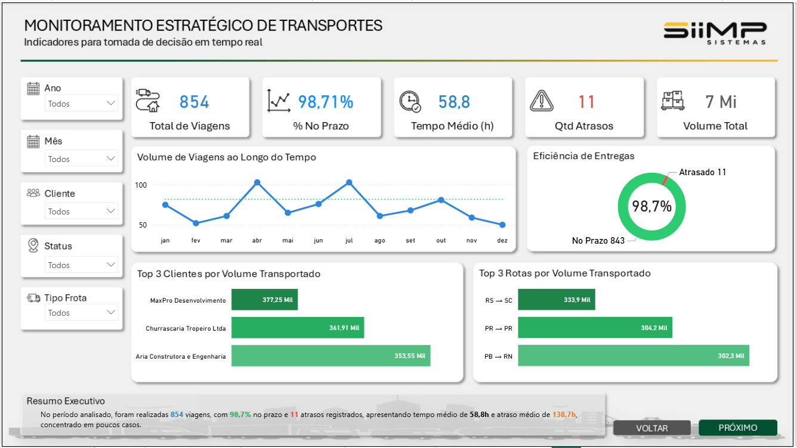

# Logística e Frota

## 1. Apresentação

Versão web complementar e arquivos Power BI preservados de Logística e Frota, com tabelas, medidas DAX, consultas Power Query e relacionamentos disponíveis para avaliação técnica.

## 2. Problema de negócio

Analisar viagens, prazos, rotas, clientes, motoristas e frota.

## 3. Objetivo

Disponibilizar uma experiência demonstrativa no navegador e material técnico reproduzível, preservando os relatórios existentes.

## 4. Funcionalidades

Páginas Capa, Painel Executivo, Painel Operacional, Painel Logístico, Painel de Diagnostico. Filtros, seleção de categorias, gráficos, indicadores, detalhamento de tabelas e navegação por dimensões; consulta do Power BI original.

## 5. Tecnologias

HTML, CSS, JavaScript ES modules e SVG. Node.js 22 ou superior somente para testes. Python 3 somente para servidor local e scripts de preparação. A interface não instala bibliotecas, não exige login e não consulta serviços de negócio.

## 6. Arquitetura

Dados locais → seleção no navegador → cálculos JavaScript → apresentação HTML/SVG. [Detalhes](docs/ARQUITETURA.md).

## 7. Estrutura

```text
originais/  PBIX e XLSX intactos + SHA256.json
modelo/     DAX, M, esquema, relações e Report/Layout
web/        Interface estática e snapshot das tabelas
tests/      Integridade e valores de reconciliação independentes
scripts/    Extração local opcional
docs/       Arquitetura, metodologia e capturas
```

## 8. Instalação

Clone este repositório. Para abrir a aplicação use um servidor HTTP local; abrir o HTML diretamente por file:// impede o carregamento do JSON em alguns navegadores. Não é necessário `npm install`.

## 9. Configuração

Sem `.env`, senha, chave ou conta Power BI para usar a versão web. Todos os arquivos necessários estão em `web/`.

## 10. Execução

```sh
python -m http.server 8000 --directory web
```

Abra http://localhost:8000. Na web publicada: [abrir dashboard](https://leandroaugferreira.github.io/dashboards/logistico/).

## 11. Testes

```sh
node --test tests/*.test.mjs
```

Os testes verificam identidades de negócio e integridade. [Validação](docs/VALIDACAO.md). O workflow usa permissões de leitura e não executa integrações de negócio.

## 12. Evidências reais

A imagem abaixo é a captura original do Power BI já apresentada no portfólio; não é uma captura da versão web. [Navegar pela versão web](https://leandroaugferreira.github.io/dashboards/logistico/).



## 13. Limitações

Esta aplicação JavaScript não incorpora o motor DAX nem os visuais proprietários do Power BI. Reproduz os indicadores, organização e fundos extraídos com renderização própria SVG/HTML. A árvore de decomposição é manual e os mapas usam malhas locais, sem geocodificação ou nós de IA. Não se afirma equivalência visual pixel a pixel nem equivalência a todo estado possível de filtros do Power BI. O original completo continua disponível, sem ser substituído.

## 14. Estado e dados

O autor confirmou em 03/11/2026 que as bases são fictícias/didáticas e autorizadas para publicação. Os PBIX e XLSX em originais/ são cópias binárias verificadas por SHA-256. O snapshot web foi extraído offline com PBIXRay 0.15.5, sem atualizar o modelo, recalcular colunas ou mudar dados. Datas são serializadas em ISO 8601; números mantêm a precisão disponível no modelo. Cálculos de apresentação usam as tabelas já transformadas do PBIX.

| Tabela do modelo | Linhas |
| --- | ---: |
| 01 - Medidas | 1 |
| dCalendario | 730 |
| dCliente | 26 |
| dEmpresa | 2 |
| dFaixaTempo | 6 |
| dRotas | 30 |
| dStatus | 4 |
| dVeículos | 48 |
| fViagens | 854 |

O snapshot não atualiza automaticamente. Preserve os originais e gere outra exportação apenas após revisar a fonte. A extração opcional está em scripts/extrair.py. A atualização do PBIX no Desktop pode exigir ajustar os caminhos de origem para a pasta local; não há alteração automática dos arquivos.

A publicação foi autorizada pelo autor. Não foi atribuída uma nova licença ao código ou às bases. Materiais didáticos de terceiros mantêm sua origem e não são apresentados como uma implantação empresarial do autor.

## 15. Portfólio

[Página do projeto](https://leandroaugferreira.github.io/transporte.html) · [Perfil GitHub](https://github.com/LeandroAugFerreira)
