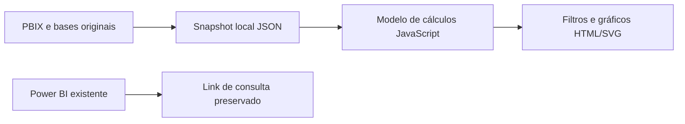

# Arquitetura — Logística e Frota

Todo o processamento da versão web acontece no navegador. Não há backend, emissão de documentos, e-mail, telemetria ou transferência da base para APIs de terceiros. Arquivos geográficos locais são recursos cartográficos, não acrescentam nem alteram registros de negócio.

O autor confirmou em 03/11/2026 que as bases são fictícias/didáticas e autorizadas para publicação. Os PBIX e XLSX em originais/ são cópias binárias verificadas por SHA-256. O snapshot web foi extraído offline com PBIXRay 0.15.5, sem atualizar o modelo, recalcular colunas ou mudar dados. Datas são serializadas em ISO 8601; números mantêm a precisão disponível no modelo. Cálculos de apresentação usam as tabelas já transformadas do PBIX.
